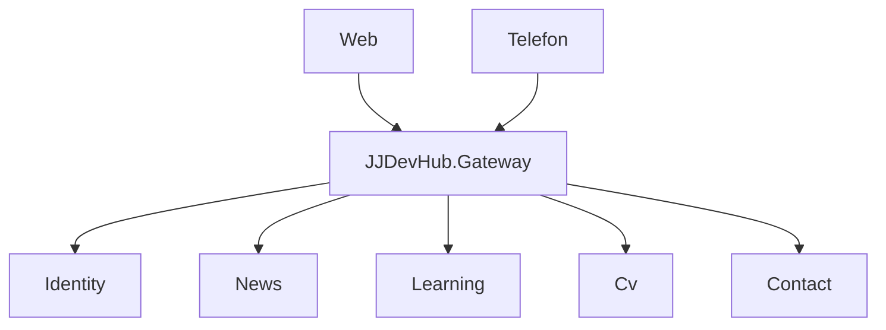

# JJDevHub

Strona CV i kompendium kursów. Właściciel, rola `owner`, edytuje treść. Student czyta lekcje i pisze do właściciela. Rekruter czyta publiczne CV i wysyła osobne zapytanie. Ta sama treść idzie do przeglądarki i na telefon.

Pięć usług .NET trzyma własne bazy na jednym PostgreSQL. Między usługami jedzie zdarzenie przez Kafkę. Przeglądarka i telefon znają jeden adres: bramę. Sekret zostaje poza repozytorium.

Specyfikacja leży w [`.docs`](.docs/README.md). Kod usług, workflow i ekrany powstają stamtąd, jeden numer na jeden pull request. Nazwy są w [słowniku](.docs/00-fundamenty/slownik.md). Decyzje są w [technologiach](.docs/00-fundamenty/technologie.md). Obraz systemu jest w [architekturze](.docs/00-fundamenty/architektura.md). Sposób pracy jest w [zasadach](.docs/00-fundamenty/zasady-pracy.md). Data zamkniętego numeru jest w [postępie](.docs/00-fundamenty/postep.md).

## Granice

Brama `JJDevHub.Gateway` nie ma domeny. Usługa otwiera swoje dwie bazy i publikuje fakt na szynę. Cudze `Contracts` wolno referencjonować przy konsumpcji zdarzenia integracyjnego. Link między usługami jest slugiem. Identyfikator z cudzej bazy nie wchodzi do zdarzenia.



Tunel Cloudflare kończy się na YARP. Szyna nie przechodzi przez bramę. `GET /versions` zwraca sześć pól: `identity`, `news`, `learning`, `cv`, `contact`, `gateway`. Brak wdrożenia to pusty napis.

| Ścieżka | Cel |
| --- | --- |
| `/versions` | brama |
| `/health/live`, `/health/ready` | proces, który dostał żądanie |
| `/connect/` i `/.well-known/` | Identity |
| `/identity/` | Identity |
| `/learning/` | Learning |
| `/news/` | News |
| `/cv/` | Cv |
| `/contact/` | Contact |
| `/graphql` | Learning |

## Usługi

| Usługa | Stan | Zapis | Odczyt |
| --- | --- | --- | --- |
| Identity | `Account`, `Invite`, saga rejestracji, audyt | EF Core w `identity_write` | skrót konta w `identity_read` |
| Learning | `Category`, `Technology`, `Course`, `Lesson`, `StudentProgress` | EF Core w `learning_write` | katalog w `learning_read` |
| News | strumień `Article` | dopisanie zdarzeń w `news_write` | notatka w `news_read` |
| Cv | strumienie sekcji CV | dopisanie zdarzeń w `cv_write` | strona w `cv_read` |
| Contact | `StudentInquiry`, `RecruiterInquiry`, token urządzenia | EF Core w `contact_write` | dwie listy w `contact_read` |

Zapis i wiersz outboxa idą w jednej transakcji. Relay publikuje fakt. Projektor z inboxem składa bazę odczytu. `GET` czyta Dapperem. Zaraz po `POST` odczyt może jeszcze nie widzieć wiersza.

Event sourcing mają News (`Article`) i Cv (`Profile`, `Position`, `Project`, `Education`, `Activity`, `Skill`, `Language`). Identity, Learning i Contact trzymają bieżący stan w EF Core. `Skill` trzyma slug technologii.

`JJDevHub.Shared.Kernel` zna `Result`, `Entity` i `ValueObject`. Od numeru agregatu zna też mechanikę strumienia. Agregatów usług nie zna. Oczekiwany błąd to `Result`. Brzeg zamienia go na `ProblemDetails`. Kultury na start to `pl` i `en`.

## Projekty

Usługa z domeną ma projekty `Domain`, `Application`, `Infrastructure`, `Api`, `Contracts`, `Relay` i `Projector`. Ścieżka to `src/services/<Nazwa>/`. `<Nazwa>` przyjmuje `Identity`, `News`, `Learning`, `Cv`, `Contact`.

| Nazwa | Ścieżka |
| --- | --- |
| `JJDevHub.Shared.Kernel` | `src/shared/JJDevHub.Shared.Kernel` |
| `JJDevHub.EventStore` | `src/shared/JJDevHub.EventStore` |
| `JJDevHub.ServiceDefaults` | `src/service-defaults/JJDevHub.ServiceDefaults` |
| `JJDevHub.AppHost` | `src/apphost/JJDevHub.AppHost` |
| `JJDevHub.Gateway` | `src/gateway/JJDevHub.Gateway` |
| web | `src/clients/web` |
| telefon | `src/clients/mobile` |

`Domain` zna jądro. `Application` zna `Domain`, porty i własne `Contracts`. `Api` składa hosta w `Program.cs` i jest jedynym miejscem, które wiąże port z implementacją. Solucja nazywa się `JJDevHub.slnx`. Framework to `net10.0`. Wersje pakietów są w `Directory.Packages.props`. SDK jest przypięty w `global.json`.

## Bazy

Jeden proces PostgreSQL 18, obraz `postgres:18`, zasób Aspire `postgres`. Zapis i odczyt są osobnymi bazami.

| Baza | Usługa |
| --- | --- |
| `identity_write`, `identity_read` | Identity |
| `news_write`, `news_read` | News |
| `learning_write`, `learning_read` | Learning |
| `cv_write`, `cv_read` | Cv |
| `contact_write`, `contact_read` | Contact |

Redis, w fazie klastra, trzyma gorącą kopię odczytu. Klucz ma prefiks nazwy usługi. Dane zostają w PostgreSQL.

## Szyna

Broker to `apache/kafka:4.4.0` w trybie KRaft, zasób `kafka`. `auto.create.topics.enable` jest wyłączone. Nazwa faktu ma postać `segment.fakt-z-myślnikami.vN` i pochodzi z `EventNameAttribute`.

| Topic | Klucz | Uwaga |
| --- | --- | --- |
| `learning.catalog` | slug | fakty katalogu |
| `learning.integration` | slug | kompaktowany, ostatni stan technologii i kursu |
| `news.articles` | slug | fakty notatki |
| `identity.registration` | identyfikator sagi | prośba rejestracji |
| `learning.enrollment` | identyfikator sagi | potwierdzenie albo odmowa zapisu studenta |
| `cv.sections` | identyfikator sekcji | fakty sekcji CV |
| `contact.integration` | identyfikator zapytania | dwa fakty push |
| `audit.events` | identyfikator encji | skrót wpisu audytu, jedna partycja |

Grupy konsumentów: `<usługa>-projector`, a dla Contact dodatkowo `contact-sse` i `contact-push`. Cv składa stronę z kopii ostatniego stanu na `learning.integration`.

## Tożsamość

OpenIddict wystawia token: authorization code z PKCE, klucz publiczny na JWKS. Brama i usługi walidują podpis. Claim roli nazywa się `role`. Wartość to `owner` albo `student`. Rekruter nie ma konta. Rejestracja studenta jest sagą w `identity_write`. Audyt zmiany właściciela jest append-only. Hash chain jest per encja.

Do czasu Identity lokalny token bierze się z `dotnet user-jwts` i ma te same claimy. Wartość sekretu na laptopie jest w user secrets. Na maszynie, do numeru OpenBao, jest w `/etc/jjdevhub/compose.env`. Potem jest w OpenBao.

## Klienci

Adres publiczny zaczyna się od `/:lang`, gdzie `lang` to `pl` albo `en`: skrót CV, technologie, kursy, lekcje, notatki i formularz rekrutera. `/login`, `/register` i `/intranet` tego segmentu nie mają. Formularz studenta jest pod `/:lang/student/contact`. Intranet właściciela edytuje CV, notatki i kursy oraz ma dwie skrzynki: `/intranet/contact/students` i `/intranet/contact/recruiters`.

Telefon (Expo, React Native) ma ekrany o tych samych nazwach rzeczy. Edytory zostają w intranecie webu. Contact wysyła dwa pushe na telefon właściciela: studenci i rekruterzy.

Wygląd: tło `#f3efe6`, atrament `#1a1814`, akcent `#9a3412`, krój Inter. Heks stoi w `src/clients/shared/theme/tokens.ts`. Teksty chromu są w `src/clients/shared/i18n/pl.json` i `en.json`, z tym samym zestawem kluczy. Stopka webu pokazuje `web-vX.Y.Z`. Ekran O aplikacji pokazuje `mobile-vX.Y.Z`. Pod spodem jest sześć wierszy z `GET /versions`.

## Stos

| Decyzja | Wybór |
| --- | --- |
| Framework | `net10.0`, SDK w `global.json` |
| Skład lokalny | .NET Aspire 13, `aspire run` |
| Baza | PostgreSQL 18 |
| Zapis | EF Core 10 i `Npgsql.EntityFrameworkCore.PostgreSQL` |
| Odczyt | Dapper |
| Szyna | Kafka KRaft, klient `Confluent.Kafka` |
| Tożsamość | OpenIddict |
| Brama | YARP |
| Telemetria | OpenTelemetry, na maszynie `grafana/otel-lgtm` |
| Web | React 19, Vite, TypeScript, TanStack Query, Tailwind CSS 4 |
| Telefon | Expo, React Native, NativeWind |
| Pakiety JS | pnpm |
| Klaster | k3s, Kustomize, kind do ćwiczeń |
| Maszyna | Terraform, jedna VM |
| Sekrety | OpenBao |
| Rejestr obrazów | GHCR |
| CI | GitHub Actions na `ubuntu-latest` |

Pakiety, licencje i lista odrzucona są w [technologie.md](.docs/00-fundamenty/technologie.md). Licencja repozytorium to GNU AGPL 3.0, plik [LICENSE](LICENSE).

Na laptopie `aspire run` stawia Postgresa, Kafkę, `otel-lgtm` i projekty, które AppHost już zna. Dashboard Aspire zostaje przy laptopie. Na maszynie, do fazy klastra, działa compose wygenerowany z AppHosta. Jedyna publiczna ścieżka HTTP to tunel na bramę. Po fazie klastra ten sam tag wchodzi na k3s. Wariant Azure jest katalogiem `deploy/terraform/azure` i uruchamia się świadomie.

Test bez kontenera i bez obciążenia:

```text
dotnet test --filter "Category!=Integration&Category!=Performance"
```

## Praca

Trzy długie gałęzie: `develop`, `release`, `main`. Gałąź robocza wychodzi z `develop`. Prefiksy: `feature/`, `fix/`, `docs/`, `chore/`, `ci/`, `refactor/`, `test/`, dalej kebab-case. Tytuł pull requestu na `develop` jest squashem w Conventional Commits, na przykład `feat(news): publish article revision`. Promocja `develop` na `release` i `release` na `main` jest merge commitem.

W toku jest jeden numer. Numer jest gotowy, gdy jego sekcja `## Gotowe gdy` jest spełniona, checkpoint przechodzi i w [postępie](.docs/00-fundamenty/postep.md) jest data.

Tag komponentu ma postać `<komponent>-vX.Y.Z`. Komponenty: `identity`, `news`, `learning`, `cv`, `contact`, `gateway`, `web`, `mobile`. Obraz wchodzi na maszynę z tagu na `main`. Rollback jest tym samym jobem z poprzednim tagiem tego samego komponentu.

## Mapa specyfikacji

Najpierw cały folder `00-fundamenty`. Potem foldery po kolei. W folderze pliki czyta się po numerze.

| Folder | Numery | Co zamyka |
| --- | --- | --- |
| [01-bramki](.docs/01-bramki/01-solucja.md) | `01`–`09` | Repozytorium odrzuca złą gałąź, czerwony test, sekret i znaną podatność, zanim powstanie usługa |
| [02-szkielet-i-deploy](.docs/02-szkielet-i-deploy/01-aspire.md) | `01`–`08` | Pusta brama stoi na maszynie, a ten sam job wgra później każdy tag |
| [03-learning-zapis](.docs/03-learning-zapis/01-kernel-i-domena.md) | `01`–`07` | Learning zapisuje kurs i lekcję w swojej bazie |
| [04-zdarzenia](.docs/04-zdarzenia/01-kontrakty.md) | `01`–`09` | Ta sama usługa publikuje fakt i składa z niego bazę odczytu |
| [05-tozsamosc](.docs/05-tozsamosc/01-konta-i-zaproszenia.md) | `01`–`06` | Konta, token, audyt i saga rejestracji |
| [06-news](.docs/06-news/01-agregat-i-zdarzenie.md) | `01`–`04` | Notatka ze strumieniem zdarzeń |
| [07-cv](.docs/07-cv/01-sekcje.md) | `01`–`03` | CV i kopia technologii |
| [08-contact](.docs/08-contact/01-dwa-zapytania.md) | `01`–`03` | Dwa zapytania, skrzynki i push |
| [09-rozszerzenia-api](.docs/09-rozszerzenia-api/01-graphql.md) | `01`–`02` | GraphQL katalogu i asystent kursu |
| [10-testy](.docs/10-testy/01-integracyjne.md) | `01`–`03` | Domknięcie piramidy |
| [11-web](.docs/11-web/01-motyw.md) | `01`–`07` | Przeglądarka |
| [12-mobile](.docs/12-mobile/01-szkielet-expo.md) | `01`–`04` | Telefon |
| [13-kubernetes](.docs/13-kubernetes/01-kind.md) | `01`–`08` | k3s, Terraform, sekrety, cache, drugi pod, wariant Azure |

## Kolejność

1. [01-bramki/01-solucja.md](.docs/01-bramki/01-solucja.md) — pusta solucja, `global.json`, centralne wersje pakietów.
2. [01-bramki/02-galezie.md](.docs/01-bramki/02-galezie.md) — gałęzie, tytuł, limit rozmiaru pull requestu.
3. [01-bramki/03-build-testy-format.md](.docs/01-bramki/03-build-testy-format.md) — build, testy, format.
4. [01-bramki/04-codeql.md](.docs/01-bramki/04-codeql.md) — skan kodu.
5. [01-bramki/05-zaleznosci.md](.docs/01-bramki/05-zaleznosci.md) — podatności pakietów i Dependabot.
6. [01-bramki/06-sonarqube.md](.docs/01-bramki/06-sonarqube.md) — bramka jakości.
7. [01-bramki/07-lancuch-dostaw.md](.docs/01-bramki/07-lancuch-dostaw.md) — sekrety, akcje, Scorecard.
8. [01-bramki/08-obrazy.md](.docs/01-bramki/08-obrazy.md) — skan obrazu, SBOM, atestacja.
9. [01-bramki/09-wersje.md](.docs/01-bramki/09-wersje.md) — osobny numer każdego komponentu.
10. [02-szkielet-i-deploy/01-aspire.md](.docs/02-szkielet-i-deploy/01-aspire.md) — AppHost i `ServiceDefaults`.
11. [02-szkielet-i-deploy/02-gateway.md](.docs/02-szkielet-i-deploy/02-gateway.md) — YARP i `GET /versions`.
12. [02-szkielet-i-deploy/03-dockerfile.md](.docs/02-szkielet-i-deploy/03-dockerfile.md) — jeden Dockerfile.
13. [02-szkielet-i-deploy/04-maszyna.md](.docs/02-szkielet-i-deploy/04-maszyna.md) — VM i runner.
14. [02-szkielet-i-deploy/05-cloudflare.md](.docs/02-szkielet-i-deploy/05-cloudflare.md) — DNS i tunel.
15. [02-szkielet-i-deploy/06-compose.md](.docs/02-szkielet-i-deploy/06-compose.md) — compose z AppHosta.
16. [02-szkielet-i-deploy/07-deploy.md](.docs/02-szkielet-i-deploy/07-deploy.md) — pierwszy rollout i rollback.
17. [02-szkielet-i-deploy/08-telemetria.md](.docs/02-szkielet-i-deploy/08-telemetria.md) — `otel-lgtm` na maszynie.
18. [03-learning-zapis/01-kernel-i-domena.md](.docs/03-learning-zapis/01-kernel-i-domena.md) — `Result` i model Learning.
19. [03-learning-zapis/02-use-case-i-porty.md](.docs/03-learning-zapis/02-use-case-i-porty.md) — handlery i porty.
20. [03-learning-zapis/03-postgres.md](.docs/03-learning-zapis/03-postgres.md) — serwer i dziesięć baz.
21. [03-learning-zapis/04-ef-core.md](.docs/03-learning-zapis/04-ef-core.md) — zapis Learning.
22. [03-learning-zapis/05-rest.md](.docs/03-learning-zapis/05-rest.md) — HTTP, błędy, `ETag`, idempotencja.
23. [03-learning-zapis/06-kurs-i-lekcja.md](.docs/03-learning-zapis/06-kurs-i-lekcja.md) — kurs, lekcja, postęp.
24. [03-learning-zapis/07-ef-zaawansowany.md](.docs/03-learning-zapis/07-ef-zaawansowany.md) — interceptory, konwertery, dziedziczenie.
25. [04-zdarzenia/01-kontrakty.md](.docs/04-zdarzenia/01-kontrakty.md) — rekordy i nazwy faktów.
26. [04-zdarzenia/02-outbox.md](.docs/04-zdarzenia/02-outbox.md) — outbox w transakcji zapisu.
27. [04-zdarzenia/03-kafka.md](.docs/04-zdarzenia/03-kafka.md) — broker KRaft i topiki.
28. [04-zdarzenia/04-relay.md](.docs/04-zdarzenia/04-relay.md) — publikacja z outboxa.
29. [04-zdarzenia/05-projektor-i-inbox.md](.docs/04-zdarzenia/05-projektor-i-inbox.md) — konsument i inbox.
30. [04-zdarzenia/06-odczyt-dapper.md](.docs/04-zdarzenia/06-odczyt-dapper.md) — zapytania do bazy odczytu.
31. [04-zdarzenia/07-ewolucja-schematu.md](.docs/04-zdarzenia/07-ewolucja-schematu.md) — `v2` i upcaster.
32. [04-zdarzenia/08-slady-i-metryki.md](.docs/04-zdarzenia/08-slady-i-metryki.md) — ślad przez Kafkę.
33. [04-zdarzenia/09-health-i-odpornosc.md](.docs/04-zdarzenia/09-health-i-odpornosc.md) — probe i circuit breaker.
34. [05-tozsamosc/01-konta-i-zaproszenia.md](.docs/05-tozsamosc/01-konta-i-zaproszenia.md) — `Account` i `Invite`.
35. [05-tozsamosc/02-openiddict.md](.docs/05-tozsamosc/02-openiddict.md) — authorization code i PKCE.
36. [05-tozsamosc/03-jwt-i-policies.md](.docs/05-tozsamosc/03-jwt-i-policies.md) — walidacja w usługach i w bramie.
37. [05-tozsamosc/04-audyt.md](.docs/05-tozsamosc/04-audyt.md) — hash chain.
38. [05-tozsamosc/05-saga-rejestracji.md](.docs/05-tozsamosc/05-saga-rejestracji.md) — rejestracja z zaproszenia.
39. [05-tozsamosc/06-twardnienie-api.md](.docs/05-tozsamosc/06-twardnienie-api.md) — limit, CORS, nagłówki.
40. [06-news/01-agregat-i-zdarzenie.md](.docs/06-news/01-agregat-i-zdarzenie.md) — agregat `Article`.
41. [06-news/02-strumien.md](.docs/06-news/02-strumien.md) — magazyn strumienia.
42. [06-news/03-zapis.md](.docs/06-news/03-zapis.md) — komendy notatki.
43. [06-news/04-odczyt-markdown.md](.docs/06-news/04-odczyt-markdown.md) — projekcja i sanitacja.
44. [07-cv/01-sekcje.md](.docs/07-cv/01-sekcje.md) — sekcje CV jako strumienie.
45. [07-cv/02-kopia-technologii.md](.docs/07-cv/02-kopia-technologii.md) — temat kompaktowany.
46. [07-cv/03-strona-publiczna.md](.docs/07-cv/03-strona-publiczna.md) — strona z jednego odczytu.
47. [08-contact/01-dwa-zapytania.md](.docs/08-contact/01-dwa-zapytania.md) — student i rekruter.
48. [08-contact/02-skrzynki-sse.md](.docs/08-contact/02-skrzynki-sse.md) — listy i strumień zdarzeń.
49. [08-contact/03-push.md](.docs/08-contact/03-push.md) — dwa kanały na telefon właściciela.
50. [09-rozszerzenia-api/01-graphql.md](.docs/09-rozszerzenia-api/01-graphql.md) — katalog przez Hot Chocolate.
51. [09-rozszerzenia-api/02-asystent.md](.docs/09-rozszerzenia-api/02-asystent.md) — pytania o kurs.
52. [10-testy/01-integracyjne.md](.docs/10-testy/01-integracyjne.md) — Testcontainers i AppHost.
53. [10-testy/02-kontraktowe.md](.docs/10-testy/02-kontraktowe.md) — Pact między Cv a Learning.
54. [10-testy/03-wydajnosciowe.md](.docs/10-testy/03-wydajnosciowe.md) — próg opóźnienia.
55. [11-web/01-motyw.md](.docs/11-web/01-motyw.md) — liczby wyglądu.
56. [11-web/02-szkielet.md](.docs/11-web/02-szkielet.md) — trasy i stopka wersji.
57. [11-web/03-klient-openapi.md](.docs/11-web/03-klient-openapi.md) — klient o typie ścieżki.
58. [11-web/04-logowanie-pkce.md](.docs/11-web/04-logowanie-pkce.md) — przeglądarka jako klient publiczny.
59. [11-web/05-tresc-publiczna.md](.docs/11-web/05-tresc-publiczna.md) — CV, kursy, notatki, formularz.
60. [11-web/06-intranet.md](.docs/11-web/06-intranet.md) — edycja właściciela.
61. [11-web/07-playwright.md](.docs/11-web/07-playwright.md) — ścieżka w przeglądarce.
62. [12-mobile/01-szkielet-expo.md](.docs/12-mobile/01-szkielet-expo.md) — Expo i te same liczby.
63. [12-mobile/02-logowanie.md](.docs/12-mobile/02-logowanie.md) — PKCE na telefonie.
64. [12-mobile/03-ekrany.md](.docs/12-mobile/03-ekrany.md) — ekrany i wersja.
65. [12-mobile/04-powiadomienia.md](.docs/12-mobile/04-powiadomienia.md) — token urządzenia.
66. [13-kubernetes/01-kind.md](.docs/13-kubernetes/01-kind.md) — lokalny klaster.
67. [13-kubernetes/02-manifesty.md](.docs/13-kubernetes/02-manifesty.md) — Deployment, StatefulSet, Kustomize.
68. [13-kubernetes/03-terraform-maszyna.md](.docs/13-kubernetes/03-terraform-maszyna.md) — VM i DNS opisane kodem.
69. [13-kubernetes/04-deploy-k3s.md](.docs/13-kubernetes/04-deploy-k3s.md) — ten sam tag na k3s.
70. [13-kubernetes/05-openbao.md](.docs/13-kubernetes/05-openbao.md) — sekrety poza plikiem env.
71. [13-kubernetes/06-redis.md](.docs/13-kubernetes/06-redis.md) — cache odczytu.
72. [13-kubernetes/07-skalowanie.md](.docs/13-kubernetes/07-skalowanie.md) — drugi pod.
73. [13-kubernetes/08-azure.md](.docs/13-kubernetes/08-azure.md) — drugi wariant Terraforma.
