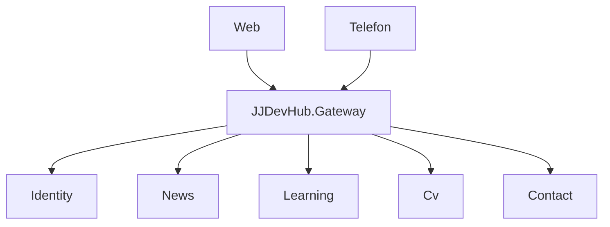
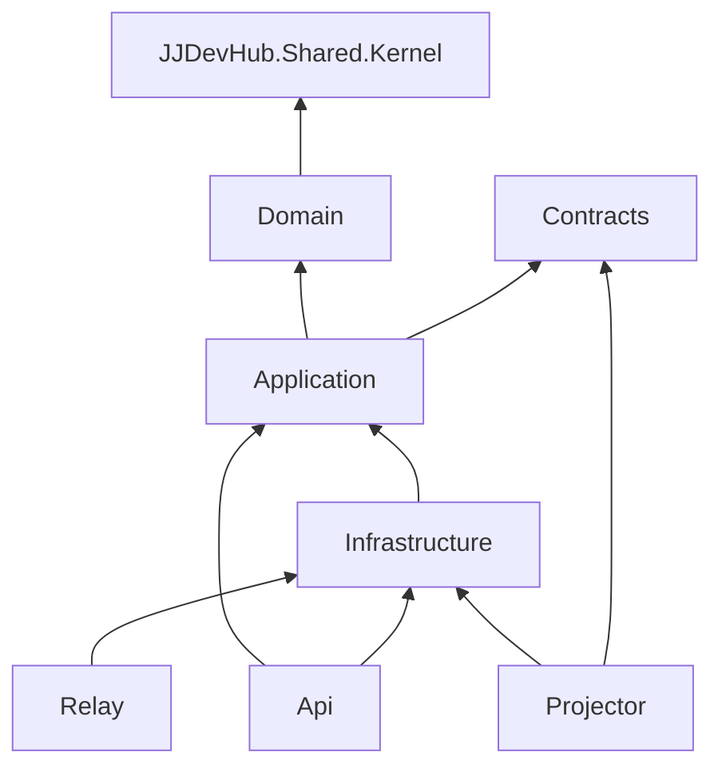
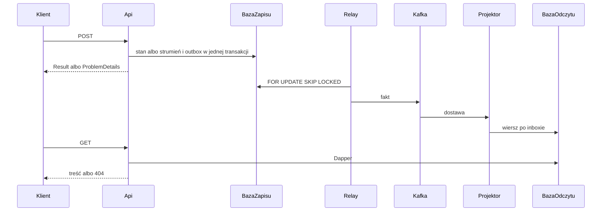

# Architektura

Ten plik jest mapą działającego systemu. Nie jest numerem i nie zawiera kroków. Nazwy są w [slownik.md](slownik.md). Kolejność prac jest w [README.md](../README.md).

JJDevHub jest stroną CV i kompendium kursów. Właściciel, rola `owner`, edytuje treść. Student czyta lekcje i pisze do właściciela. Rekruter czyta publiczne CV i wysyła osobne zapytanie. Ta sama treść idzie do przeglądarki i na telefon. Pięć usług trzyma własne bazy. Między usługami jedzie zdarzenie przez Kafkę. Sekret nie wchodzi do repozytorium.

## Granice

Brama nie ma domeny. Usługa nie otwiera bazy sąsiada i nie referencjonuje projektu `Domain`, `Infrastructure` ani `Api` sąsiada. Wolno jej referencjonować cudze `Contracts`, gdy konsumuje zdarzenie integracyjne.

Przeglądarka i telefon znają jeden adres. Brama sprawdza podpis tokenu, gdy token jest, i przekazuje żądanie. Szyna nie przechodzi przez bramę. Tunel Cloudflare kończy się na YARP.

| Usługa | Stan | Zapis | Odczyt |
| --- | --- | --- | --- |
| Identity | `Account`, `Invite`, saga rejestracji, audyt | EF Core w `identity_write` | skrót konta w `identity_read` |
| Learning | `Category`, `Technology`, `Course`, `Lesson`, `StudentProgress` | EF Core w `learning_write` | katalog w `learning_read` |
| News | strumień `Article` | dopisanie zdarzeń w `news_write` | notatka w `news_read` |
| Cv | strumienie sekcji CV | dopisanie zdarzeń w `cv_write` | strona w `cv_read` |
| Contact | `StudentInquiry`, `RecruiterInquiry`, token urządzenia | EF Core w `contact_write` | dwie listy w `contact_read` |

Event sourcing jest tam, gdzie historia jest produktem: artykuł i sekcje CV. Learning, Identity i Contact trzymają bieżący stan w EF Core. Wszystkie pięć usług idzie tą samą drogą do odczytu: zapis i wiersz outboxa w jednej transakcji, relay, Kafka, projektor z inboxem, baza odczytu, Dapper na ścieżce `GET`.

Klasa nie nazywa się jak segment namespace. W News jest `Article`. W Cv nie ma klasy `Cv`. W Contact nie ma klasy `Contact`.

`JJDevHub.Shared.Kernel` nie zna `Article`, `Account`, `Lesson`, `Profile` ani `StudentInquiry`. Zna `Result`, `Entity`, `ValueObject` i, od numeru agregatu, mechanikę strumienia.

## Warstwy usługi

| Projekt | Zna | Nie zna |
| --- | --- | --- |
| `Domain` | jądro | EF Core, Kafki, ASP.NET, Redisa |
| `Application` | `Domain`, porty, własne `Contracts` | konkretnego brokera i SQL |
| `Infrastructure` | adaptery portów | agregatu sąsiada |
| `Api` | skład hosta w `Program.cs` | reguły wpisanej w endpoint |
| `Contracts` | rekordy zdarzeń integracyjnych | handlerów |
| `Relay` | odczyt outboxa i producenta | reguły domeny |
| `Projector` | konsumenta, inbox i zapis odczytu | komendy HTTP |

`Api` jest jedynym miejscem, które wiąże port z implementacją. Test `Domain` nie podnosi kontenera. `Contracts` wolno referencjonować z innej usługi.

## Zapis i odczyt

Jeden proces PostgreSQL. Dziesięć baz. Zapis i odczyt są osobnymi bazami, nie dwoma schematami jednego connection stringa. Dwa schematy odpadły, bo ten sam ciąg nadal sięga obu schematów. Osobny serwer na usługę odpadł, bo strumień albo wiersz stanu i outbox mają jeden commit.

Handler komendy nie otwiera bazy odczytu. Handler zapytania nie woła magazynu strumienia ani `DbContext` zapisu. Zaraz po `POST` odczyt może jeszcze nie widzieć wiersza i zwraca `404`. Klient ponawia. To jest stan przejściowy, nie błąd komendy.

Redis, gdy dojdzie, trzyma gorącą kopię. Utrata Redisa spowalnia `GET`. Dane zostają w PostgreSQL. Do tego numeru cache procesu to `IMemoryCache` i też ginie bez utraty zapisu. Klucz ma prefiks nazwy usługi.

Link między usługami jest slugiem. Identyfikator z cudzej bazy nie wchodzi do zdarzenia integracyjnego. Slug technologii nie zmienia się po publikacji. Cv nie woła Learning po HTTP, żeby złożyć stronę. Czyta kopię ostatniego stanu z tematu `learning.integration`.

## Tożsamość i audyt

Identity wystawia token przez OpenIddict: authorization code z PKCE, klucz publiczny na JWKS. Brama i usługi walidują podpis. Klucz prywatny zostaje w Identity. Do czasu Identity lokalny token bierze się z `dotnet user-jwts` i ma te same claimy `owner` albo `student`.

Rejestracja studenta jest sagą. Identity tworzy konto w stanie oczekiwania i publikuje fakt. Learning potwierdza zapis uczestnictwa albo odmawia. Timeout kompensuje konto. Maszyna stanów leży w `identity_write`.

Audyt zmiany właściciela jest append-only. Hash chain jest per encja. Wpisu nie da się zaktualizować przez `DbContext`.

## Błędy

Oczekiwany błąd to `Result`. Wyjątek zostaje dla awarii IO i błędu składu hosta. Brzeg zamienia oba na `ProblemDetails`. Pole `type` jest kodem `segment.element.powod`. Pole `title` jest tłumaczone z `Accept-Language`. Kultury na start to `pl` i `en`.

| Sytuacja | Status |
| --- | --- |
| walidacja kształtu żądania | `400` |
| reguła domeny, rodzaj `Invalid` | `422` |
| brak tokenu | `401` |
| zła rola, rodzaj `Forbidden` | `403` |
| brak wiersza albo treść niewidoczna | `404` |
| konflikt wersji, rodzaj `Conflict` | `409` |
| brak `If-Match` przy zapisie wersjonowanym | `428` |
| nieaktualny `If-Match` | `412` |

Treść niewidoczna dla czytelnika jest `404`, nie `403`, żeby status nie zdradzał, że wiersz istnieje.

## Skład i runtime

Na laptopie `aspire run` stawia to, co AppHost już zna: Postgresa, Kafkę, `otel-lgtm` i projekty. Dashboard Aspire zostaje przy laptopie. AppHost nie jedzie na produkcję.

Na maszynie, do fazy klastra, działa compose wygenerowany z AppHosta. Jedyna publiczna ścieżka HTTP to tunel na bramę. Po fazie klastra ten sam tag wchodzi na k3s. HPA może podnieść drugi pod. Postgres, Kafka, OpenBao, Redis, telemetria i konektor tunelu nie dostają HPA.

Wariant Azure jest osobnym katalogiem Terraforma. Nie zastępuje maszyny. Uruchamia się go świadomie.

## Spójność

| Reguła | Skutek złamania |
| --- | --- |
| Usługa ma tylko swoje dwie bazy | wyciek zapisu albo odczytu sąsiada |
| Komenda nie widzi bazy odczytu | reguła zależy od projekcji, która może być w tyle |
| Zapytanie nie widzi strumienia | `GET` składa historię i omija indeks |
| Pole agregatu zmienia się w `Apply` | `Replay` buduje inny stan niż komenda |
| Nazwa zdarzenia pochodzi z atrybutu | zmiana nazwy klasy zmienia kontrakt |
| Outbox w transakcji zapisu | szyna ma fakt, którego nie ma w bazie |
| Inbox przed skutkiem | drugi pod wysyła drugi push |
| Sekret poza gitem | wartość zostaje w historii repozytorium |
