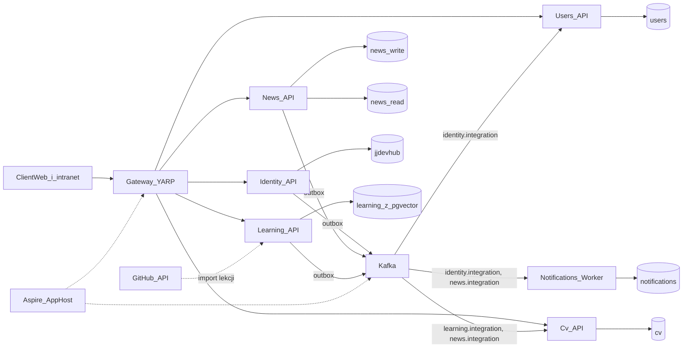
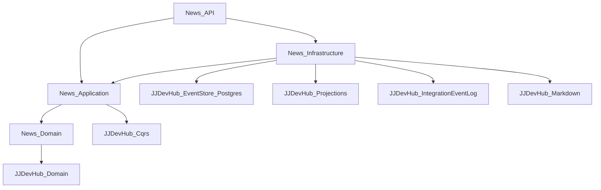
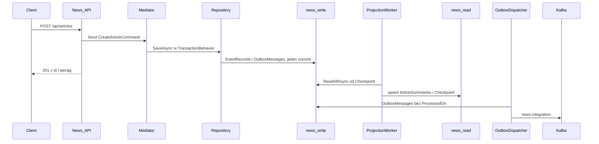
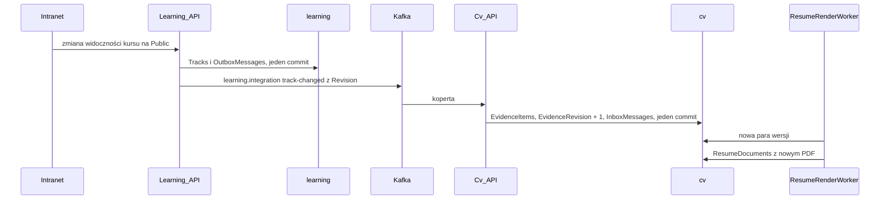

# Architektura

Obraz całości, do którego prowadzą numery `01`–`22`. Ten plik nie jest numerem: nie ma kroków do wygenerowania. Mówi, które usługi istnieją, co do kogo należy i jak płyną dane. Kolejność i słownik są w [README.md](README.md).

## Po co

Każdy numer opisuje tylko swój kawałek. Ten plik pilnuje, żeby kawałki składały się w system z wyraźnymi granicami: usługa ma własną bazę, własny kontrakt na szynie i nie zagląda do sąsiada. To samo cięcie ma eShop: `Ordering.API` nie czyta bazy `Catalog.API`, tylko dostaje zdarzenie.

## Usługi

| Usługa | Styl | Publikuje | Konsumuje | Numer |
| --- | --- | --- | --- | --- |
| Identity | EF + ASP.NET Identity, role, zaproszenia | `identity.integration`: `UserRegisteredIntegrationEvent` | — | `15` |
| News | DDD, event sourcing, CQRS | `news.integration`: utworzenie, publikacja, wycofanie | — | `01`–`11`, `16`, `21` |
| Users | EF, CRUD | — | `identity.integration` | `17` |
| Notifications | worker, HTTP tylko `/health` i `/metrics` | — | `identity.integration`, `news.integration` | `17`, `21` |
| Learning | DDD na EF, CQRS, wyszukiwanie w Postgresie | `learning.integration`: pełny stan technologii, kursu, wykładu, hasła | — | `19`, `20` |
| Cv | EF w jednym projekcie, kopia dowodów | — | `learning.integration`, `news.integration` | `22` |
| Gateway | YARP, bez logiki | — | — | `16` |

Event sourcing jest tylko w News. To świadomy wybór, jak w eShop, gdzie DDD dostaje `Ordering`, a `Catalog` jest zwykłym CRUD-em. Artykuł ma historię wartą odtwarzania: powstanie, rewizje, publikację, wycofanie, a widok historii w [21-notatki.md](21-notatki.md) powstaje z tych samych zdarzeń. Kurs w Learning ma reguły (kolejność lekcji, widoczność, import), ale jego historia nikogo nie interesuje, więc to agregat na EF. CV to jeden dokument z regułami i kopią cudzych faktów.

Klient web jest jeden. Strona publiczna, strefa studenta i intranet właściciela to trasy tego samego klienta, rozróżniane rolą z tokenu ([docs/frontend/intranet/01-dostep-i-trasy.md](../frontend/intranet/01-dostep-i-trasy.md)).

## Tematy

| Temat | Właściciel | Partycje | Polityka | Konsumenci | Numer |
| --- | --- | --- | --- | --- | --- |
| `identity.integration` | Identity | 3 | retencja 7 dni | `users`, `notifications` | `13`, `15` |
| `news.integration` | News | 3 | retencja 7 dni | `notifications`, `cv` | `13`, `21`, `22` |
| `learning.integration` | Learning | 3 | `cleanup.policy=compact` | `cv` | `19`, `22` |
| `*.dlq` | konsument | 1 | retencja 7 dni | człowiek, przez Kafka UI | `13` |

Kluczem wiadomości jest id agregatu, więc zdarzenia jednego artykułu albo kursu przychodzą w kolejności zapisu. Nowa grupa konsumentów czyta od początku tematu (`AutoOffsetReset = Earliest`).

## Dwa rodzaje zdarzeń integracyjnych

Zdarzenie powiadamiające mówi, co się stało, i niesie tylko to, czego konsument potrzebuje do reakcji. `UserRegisteredIntegrationEvent` mówi „ktoś się zarejestrował”, a Users i Notifications reagują. Konsument nie odtwarza z niego stanu.

Zdarzenie ze stanem (event-carried state transfer) niesie cały bieżący stan agregatu z numerem wersji. `track-changed` w Learning i `article-published` w News niosą tytuł, slug, widoczność i powiązania. Cv trzyma ich kopię i nie musi pytać właściciela o nic. Zasady:

- jedno zdarzenie na każdy zapis agregatu, z pełnym stanem, a nie z różnicą,
- wersja (`Revision` w Learning, `Version` strumienia w News) rośnie z każdym zapisem; konsument pomija wiadomość z wersją nie wyższą od zapisanej,
- usunięcie to wiadomość z `IsDeleted` albo wycofaniem, nie brak wiadomości,
- widoczność jedzie w zdarzeniu, a filtr robi konsument przy odczycie, bo musi zobaczyć także przejście z publicznego na prywatne,
- powiązania między usługami idą po slugu, który się nie zmienia, a nie po id z cudzej bazy,
- właściciel ma `republish`, który zapisuje bieżący stan wszystkich agregatów do outboxa, dla nowego konsumenta albo nowej wersji kontraktu.

Kompaktowanie `learning.integration` zostawia w temacie ostatnią wiadomość dla każdego klucza, więc nowy konsument dostaje pełny stan bez `republish`. `news.integration` ma retencję czasową, bo niesie też powiadomienia, i tam `republish` jest jedyną drogą do starszych notatek.

## Warstwy usługi z domeną

- `News.Domain`: agregat, zdarzenia, value objecty, reguły. Zależy tylko od `JJDevHub.Domain`. Bez EF, bez JSON-a.
- `News.Application`: komendy, zapytania, walidatory, porty (`IArticleSummaryReader`). Zna `IRepository<Article>` i `IIntegrationEventOutbox` jako interfejsy.
- `News.Infrastructure`: `NewsWriteContext`, `NewsReadContext`, projekcje, czytniki, upcastery, rejestracja w DI.
- `News.API`: endpointy i skład. Jedyny projekt z `Program.cs`.
- `News.Contracts`: rekordy zdarzeń integracyjnych. Referencjonują go konsumenci, nic więcej.

Learning ma te same pięć projektów. Różnica jest w Infrastructure: `LearningContext` na EF zamiast magazynu zdarzeń, a obok wyszukiwanie i klient GitHuba. Cv i Users mają jeden projekt, bo domena jest mała.

To jest cebula z GeekLemon i układ `Ordering.*` z eShop: strzałki idą do środka, domena nie wie o bazie.

## Przepływ zapisu i odczytu

Odczyt jest ostatecznie spójny. `POST` zwraca id i wersję, a `GET` może przez chwilę zwrócić 404, zanim worker dojdzie do pozycji. Klient web po `201` przechodzi na widok z tym id i ponawia odczyt. To koszt rozdzielenia baz, opisany w [10-projekcja.md](10-projekcja.md).

## Przepływ dowodu do CV

Strona CV po tej sekwencji ma nowy `ETag` i nowy kurs przy umiejętności. Learning nie wie, że Cv istnieje.

## Granice

- Usługa ma swoje bazy i swój temat Kafki. Cudza baza jest niewidoczna, cudzy temat tylko do czytania.
- Między usługami idzie zdarzenie integracyjne, nie wywołanie HTTP cudzej komendy. Zapytanie HTTP do sąsiada jest dopuszczalne tylko przez gateway i tylko z klienta.
- Zdarzenie domenowe nie opuszcza usługi. Na szynę wychodzi osobny rekord z `*.Contracts`, mapowany w Application.
- `IdentityGuid` jest jedynym wspólnym identyfikatorem użytkownika. Hasło i tabele `AspNetUsers` zostają w Identity.
- Token wydaje Identity (klucz RSA) z rolami `owner` i `student`. Reszta usług tylko go waliduje kluczem publicznym z JWKS i sprawdza politykę z `ServiceDefaults`.
- Treść łączy się między usługami slugiem. Notatka w News wskazuje lekcję w Learning slugiem kursu i lekcji, a News tego nie sprawdza.
- Jedyne wyjście do internetu z usług to Learning do `api.github.com` przy imporcie lekcji, ze stałym adresem bazowym i bez przekierowań.

## Środowiska

| Środowisko | Skład | Sekrety | Telemetria |
| --- | --- | --- | --- |
| dev | `aspire run`: AppHost stawia Postgresa z pgvector, Kafkę z Kafka UI, usługi i klienta | parametry Aspire w user secrets | dashboard Aspire |
| CI | PR na `ubuntu-latest`, `main` na `jjdevhub-build` z [18-ci-uslug.md](18-ci-uslug.md), Testcontainers w testach, bez AppHost poza `JJDevHub.AppHost.Tests` | brak sekretów aplikacji | brak |
| VM (Proxmox) | Compose wygenerowany przez `aspire publish`, obrazy tylko z wydań ([docs/CICD/11-branche-i-wydania.md](../CICD/11-branche-i-wydania.md)), atestacja sprawdzana przed `up` ([docs/CICD/13-lancuch-dostaw.md](../CICD/13-lancuch-dostaw.md)) | `infra/secrets/*.sops.env` w gicie, odszyfrowane na VM do sekretów Compose ([docs/CICD/12-sekrety.md](../CICD/12-sekrety.md)) | Jaeger, Prometheus, Grafana z [docs/CICD](../CICD/README.md) |

## Źródła

- [DDD-oriented microservice](https://learn.microsoft.com/en-us/dotnet/architecture/microservices/microservice-ddd-cqrs-patterns/ddd-oriented-microservice) — warstwy domeny, aplikacji i infrastruktury w jednej usłudze.
- [Data sovereignty per microservice](https://learn.microsoft.com/en-us/dotnet/architecture/microservices/architect-microservice-container-applications/data-sovereignty-per-microservice) — baza na usługę.
- [Asynchronous message-based communication](https://learn.microsoft.com/en-us/dotnet/architecture/microservices/architect-microservice-container-applications/asynchronous-message-based-communication) — zdarzenia zamiast wywołań między usługami.
- [What do you mean by “Event-Driven”?](https://martinfowler.com/articles/201701-event-driven.html) — Martin Fowler: powiadomienie o zdarzeniu a przenoszenie stanu w zdarzeniu.
- [Kafka log compaction](https://kafka.apache.org/documentation/#compaction) — ostatnia wartość dla klucza jako pełny stan tematu.
- [dotnet/eShop](https://github.com/dotnet/eshop) — `Ordering` z DDD obok `Catalog` jako CRUD.
- [GeekLemonConference](https://github.com/PanNiebieski/GeekLemonConference-CQRS-EventSourcing-CleanArchitecture-DDD-Example) — cebula z event sourcingiem w Infrastructure.
- [Komenda wołająca komendę](https://cezarywalenciuk.pl/blog/programing/command-wywolujacy-kolejny-command-to-kiepski-pomysl) — między kawałkami systemu idzie zdarzenie.
- Sam Newman, *Building Microservices* — granice usług i własność danych.
