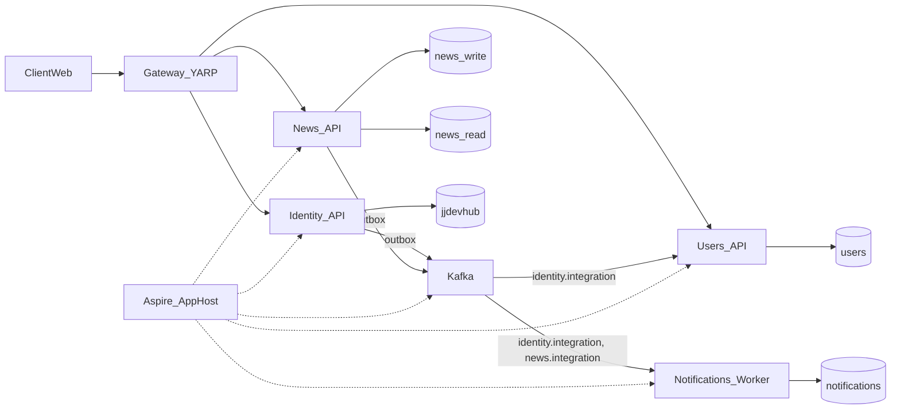
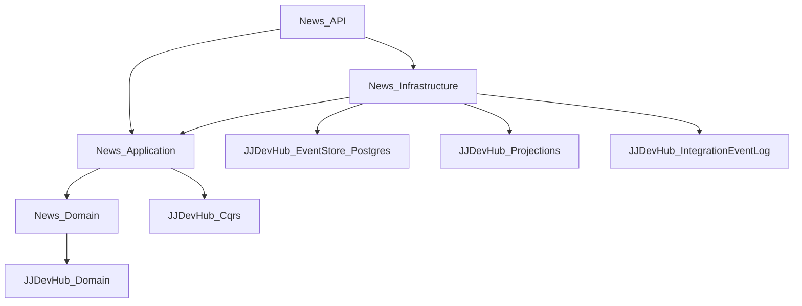
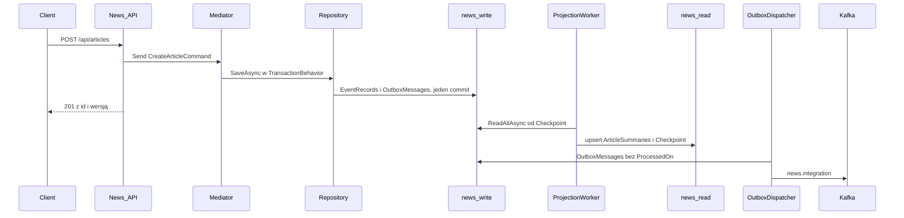

# Architektura

Obraz całości, do którego prowadzą numery `01`–`18`. Ten plik nie jest numerem: nie ma kroków do wygenerowania. Mówi, które usługi istnieją, co do kogo należy i jak płyną dane. Kolejność i słownik są w [README.md](README.md).

## Po co

Agent, który generuje jeden numer, widzi tylko swój kawałek. Ten plik pilnuje, żeby kawałki składały się w system z wyraźnymi granicami: usługa ma własną bazę, własny kontrakt na szynie i nie zagląda do sąsiada. To samo cięcie ma eShop: `Ordering.API` nie czyta bazy `Catalog.API`, tylko dostaje zdarzenie.

## Usługi

| Usługa | Styl | Publikuje | Konsumuje | Numer |
| --- | --- | --- | --- | --- |
| Identity | EF + ASP.NET Identity, CRUD | `identity.integration`: `UserRegisteredIntegrationEvent` | — | `15` |
| News | DDD, event sourcing, CQRS | `news.integration`: `ArticleCreatedIntegrationEvent` | — | `01`–`11`, `16` |
| Users | EF, CRUD | — | `identity.integration` | `17` |
| Notifications | worker bez HTTP | — | `identity.integration`, `news.integration` | `17` |
| Gateway | YARP, bez logiki | — | — | `16` |

Event sourcing jest tylko w News. To świadomy wybór, jak w eShop, gdzie DDD dostaje `Ordering`, a `Catalog` jest zwykłym CRUD-em. Profil użytkownika nie ma historii wartej odtwarzania. Artykuł ma: powstanie, rewizje, a później publikację i wycofanie.

## Warstwy usługi z domeną

- `News.Domain`: agregat, zdarzenia, value objecty, reguły. Zależy tylko od `JJDevHub.Domain`. Bez EF, bez JSON-a.
- `News.Application`: komendy, zapytania, walidatory, porty (`IArticleSummaryReader`). Zna `IRepository<Article>` i `IIntegrationEventOutbox` jako interfejsy.
- `News.Infrastructure`: `NewsWriteContext`, `NewsReadContext`, projekcja, czytnik, rejestracja w DI.
- `News.API`: endpointy i skład. Jedyny projekt z `Program.cs`.
- `News.Contracts`: rekordy zdarzeń integracyjnych. Referencjonują go konsumenci, nic więcej.

To jest cebula z GeekLemon i układ `Ordering.*` z eShop: strzałki idą do środka, domena nie wie o bazie.

## Przepływ zapisu i odczytu

Odczyt jest ostatecznie spójny. `POST` zwraca id i wersję, a `GET` może przez chwilę zwrócić 404, zanim worker dojdzie do pozycji. Klient web po `201` przechodzi na widok z tym id i ponawia odczyt. To koszt rozdzielenia baz, opisany w [10-projekcja.md](10-projekcja.md).

## Granice

- Usługa ma swoje bazy i swój temat Kafki. Cudza baza jest niewidoczna, cudzy temat tylko do czytania.
- Między usługami idzie zdarzenie integracyjne, nie wywołanie HTTP cudzej komendy. Zapytanie HTTP do sąsiada jest dopuszczalne tylko przez gateway i tylko z klienta.
- Zdarzenie domenowe nie opuszcza usługi. Na szynę wychodzi osobny rekord z `*.Contracts`, mapowany w Application.
- `IdentityGuid` jest jedynym wspólnym identyfikatorem. Hasło i tabele `AspNetUsers` zostają w Identity.
- Token wydaje Identity (klucz RSA). Reszta usług tylko go waliduje kluczem publicznym z JWKS.

## Środowiska

| Środowisko | Skład | Telemetria |
| --- | --- | --- |
| dev | `aspire run`: AppHost stawia Postgresa, Kafkę z Kafka UI i usługi | dashboard Aspire |
| CI | self-hosted runner `jjdevhub-build` z [18-ci-uslug.md](18-ci-uslug.md), Testcontainers w testach, bez AppHost poza `JJDevHub.AppHost.Tests` | brak |
| VM (Proxmox) | Compose wygenerowany przez `aspire publish`, sekrety w `/etc/jjdevhub/<usługa>.env` | Jaeger, Prometheus, Grafana z [docs/CICD](../CICD/README.md) |

## Źródła

- [DDD-oriented microservice](https://learn.microsoft.com/en-us/dotnet/architecture/microservices/microservice-ddd-cqrs-patterns/ddd-oriented-microservice) — warstwy domeny, aplikacji i infrastruktury w jednej usłudze.
- [Data sovereignty per microservice](https://learn.microsoft.com/en-us/dotnet/architecture/microservices/architect-microservice-container-applications/data-sovereignty-per-microservice) — baza na usługę.
- [Asynchronous message-based communication](https://learn.microsoft.com/en-us/dotnet/architecture/microservices/architect-microservice-container-applications/asynchronous-message-based-communication) — zdarzenia zamiast wywołań między usługami.
- [dotnet/eShop](https://github.com/dotnet/eshop) — `Ordering` z DDD obok `Catalog` jako CRUD.
- [GeekLemonConference](https://github.com/PanNiebieski/GeekLemonConference-CQRS-EventSourcing-CleanArchitecture-DDD-Example) — cebula z event sourcingiem w Infrastructure.
- [Komenda wołająca komendę](https://cezarywalenciuk.pl/blog/programing/command-wywolujacy-kolejny-command-to-kiepski-pomysl) — między kawałkami systemu idzie zdarzenie.
- Sam Newman, *Building Microservices* — granice usług i własność danych.
