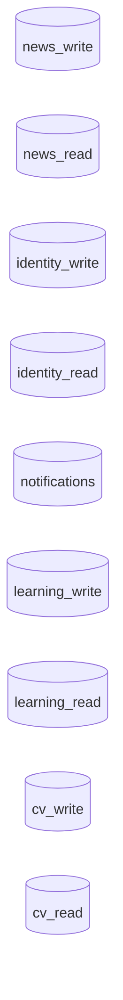

# Bazy

Jeden serwer Postgres 16. Od [20-wyszukiwanie.md](20-wyszukiwanie.md) obraz to `pgvector/pgvector:pg16`. Każda usługa ma własną bazę albo parę baz i nie czyta cudzej. Między usługami idzie zdarzenie przez Kafkę.

Connection stringi nazywają się jak zasoby Aspire: `news-write`, `news-read`, `identity-write`, `identity-read`, `notifications`, `learning-write`, `learning-read`, `cv-write`, `cv-read`.

Każda baza ma jeden kontekst EF i tabelę `__EFMigrationsHistory`. Biblioteki budulcowe nie mają migracji: dają mapowanie (`ApplyEventStore`, `ApplyIntegrationEventLog`, `Checkpoints`), a migracje są w usłudze.

| Baza | Kontekst | Zapis czy odczyt | Od numeru |
| --- | --- | --- | --- |
| `news_write` | `NewsWriteContext` | strumień, outbox, rezerwacja sluga | `06`, `12`, `21` |
| `news_read` | `NewsReadContext` | projekcja notatek i historia | `10`, `21` |
| `identity_write` | `IdentityWriteContext` | strumień konta i zaproszenia, outbox | `15` |
| `identity_read` | `IdentityReadContext` | listy kont i zaproszeń | `15` |
| `notifications` | `NotificationsContext` | ślad wysyłki, inbox | `17` |
| `learning_write` | `LearningWriteContext` | strumień treści, outbox, postęp | `19` |
| `learning_read` | `LearningReadContext` | projekcja treści, wyszukiwanie | `19`, `20` |
| `cv_write` | `CvWriteContext` | strumienie CV, rezerwacja umiejętności | `22` |
| `cv_read` | `CvReadContext` | skład CV, dowody, PDF, inbox | `22` |

## Tabele wspólne

Te same kształty wchodzą do kontekstu przez mapowanie. Nie każda baza ma wszystkie.

### `EventStreams` i `EventRecords`

Źródło prawdy agregatu. `EventRecord` się nie zmienia i nie jest usuwany. [06-postgres.md](06-postgres.md).

`EventStreams`:

| Kolumna | Typ | Rola |
| --- | --- | --- |
| `StreamId` | `string`, do 200 znaków, klucz | nazwa strumienia |
| `Version` | `int` | ostatni fakt; konflikt zapisu porównuje tę liczbę |
| `IdentityGuid` | `string?` | właściciel strumienia |

`EventRecords`:

| Kolumna | Typ | Rola |
| --- | --- | --- |
| `Position` | `bigint`, klucz, identity | globalna kolejność w tej bazie |
| `StreamId` | `string` | z `Version` unikalny indeks złożony |
| `Version` | `int` | numer faktu w strumieniu |
| `EventId` | `uuid`, unikalny | identyfikator faktu |
| `EventType` | `string` | nazwa z `[EventName]`, nie nazwa CLR |
| `Payload` | `jsonb` | treść faktu typami prostymi |
| `DateOccurred` | `timestamptz` | czas faktu |

Przedrostki strumieni:

| Baza | Strumień |
| --- | --- |
| `news_write` | `article-{guid}` |
| `identity_write` | `account-{guid}`, `invite-{guid}` |
| `learning_write` | `technology-{guid}`, `track-{guid}`, `lesson-{guid}`, `lecture-{guid}`, `term-{guid}` |
| `cv_write` | `profile-{stałe-id}`, `position-{guid}`, `project-{guid}`, `education-{guid}`, `activity-{guid}`, `skill-{guid}`, `language-{guid}` |

`notifications` nie ma strumienia.

### `OutboxMessages` i `InboxMessages`

[12-outbox-inbox.md](12-outbox-inbox.md). `ApplyIntegrationEventLog` mapuje obie tabele. Dispatcher outboxa startuje tylko tam, gdzie usługa publikuje.

`OutboxMessages`:

| Kolumna | Rola |
| --- | --- |
| `EventId` | klucz |
| `Name` | nazwa zdarzenia integracyjnego |
| `PartitionKey` | klucz Kafki, zwykle id agregatu |
| `Payload` | `jsonb`, koperta |
| `OccurredOn` | czas zdarzenia |
| `CreatedOn` | kolejność wysyłki; indeks częściowy `WHERE "ProcessedOn" IS NULL` |
| `ProcessedOn` | `timestamptz?`, puste do udanej publikacji |
| `Attempts` | licznik prób |
| `LastError` | ostatni błąd, do 2000 znaków |

`InboxMessages`: klucz (`EventId`, `Consumer`), `Name`, `ProcessedOn`.

Gdzie leżą:

| Baza | Outbox | Inbox |
| --- | --- | --- |
| `news_write` | tak | nie |
| `identity_write` | tak | nie |
| `learning_write` | tak | nie |
| `notifications` | tabela jest, dispatcher wyłączony | tak, grupa `notifications` |
| `cv_read` | tabela jest, dispatcher wyłączony | tak, grupa `cv` |

### `Checkpoints`

W każdej bazie odczytu, która ma projekcję. [10-projekcja.md](10-projekcja.md).

| Kolumna | Rola |
| --- | --- |
| `ProjectionName` | klucz, nazwa projekcji |
| `Position` | `bigint`, ostatnia przetworzona globalna pozycja strumienia zapisu |

Projekcja treści Learning trzyma przy tym wierszu także wersję renderera Markdown. Brak wiersza znaczy pozycję 0.

## `news_write`

Poza strumieniem i outboxem: `ArticleSlugs` ([21-notatki.md](21-notatki.md)).

| Kolumna | Rola |
| --- | --- |
| `Language` | z `Slug` klucz złożony |
| `Slug` | adres notatki w jednym języku |
| `ArticleId` | `uuid` strumienia |

Wiersz powstaje w tej samej transakcji co dopisanie strumienia. Duplikat klucza kończy się `Conflict`, zanim strumień powstanie.

## `news_read`

### `ArticleSummaries`

Widok listy i szczegółu. Od `10`: `ArticleId` (klucz), `Title`, `Body`, `AuthorIdentityGuid`, `CreatedOn`, `RevisedOn`, `Version`. Indeks na `CreatedOn` malejąco.

Od `21` dochodzą: `Slug`, `Language`, `Status`, `Visibility`, `FirstPublishedOn`, `LessonKind`, `LessonParentSlug`, `LessonSlug`, `BodyHtml`, `Excerpt` (do 240 znaków).

Indeksy od `21`: unikalny (`Language`, `Slug`), (`Language`, `Status`, `Visibility`, `FirstPublishedOn` malejąco), (`LessonKind`, `LessonParentSlug`, `LessonSlug`).

### `ArticleRevisions`

Historia notatki, projekcja `article-revisions`.

| Kolumna | Rola |
| --- | --- |
| `ArticleId` | z `Version` klucz |
| `Version` | numer faktu |
| `Kind` | `created`, `revised`, `published`, `withdrawn`, `attached`, `detached` |
| `Title` | tytuł w tym fakcie |
| `Body` | treść; puste, gdy fakt jej nie niesie |
| `Visibility` | widoczność w tym fakcie |
| `OccurredOn` | czas faktu |

Powtórka z tym samym kluczem nic nie zmienia.

### `Checkpoints`

`article-summaries`, `article-revisions`.

## `identity_write`

Baza zapisu Identity. Do [14-aspire.md](14-aspire.md) istniejące API łączy się z `jjdevhub`. Od `15` ta sama baza nazywa się `identity_write`: na VM, przy braku sesji, `ALTER DATABASE jjdevhub RENAME TO identity_write`. Migracja dokłada strumień, rezerwacje i outbox obok tabel `AspNet*`. `AccountImporter` przenosi `AspNetUsers` do strumieni i w tej samej transakcji usuwa `AspNetUserTokens`, `AspNetUserLogins`, `AspNetUserClaims`, `AspNetRoleClaims`, `AspNetUserRoles`, `AspNetRoles`, `AspNetUsers`.

Skrót hasła leży w `Payload` faktu `AccountRegistered`, nie w osobnej kolumnie. Zdarzenie na szynę tego skrótu nie niesie.

### `AccountEmails`

| Kolumna | Rola |
| --- | --- |
| `Email` | klucz, unikalny |
| `AccountId` | `uuid` strumienia `account-{id}` |

### `InviteCodeHashes`

| Kolumna | Rola |
| --- | --- |
| skrót SHA-256 kodu | klucz; w tabeli nie ma kodu jawnego |
| id zaproszenia | strumień `invite-{id}` |

Kod w strumieniu też jest skrótem. Jawny kod wraca raz, w odpowiedzi `POST /api/auth/invites`.

## `identity_read`

Listy intranetu. Logowanie nie czyta tych tabel: ładuje strumień konta.

### `AccountSummaries`

Służy `GET /api/auth/users`: `IdentityGuid`, e-mail, `DisplayName`, role, data utworzenia. Bez skrótu hasła. `GET /api/auth/me` nie czyta tej tabeli: ładuje strumień konta.

### `InviteSummaries`

Służy `GET /api/auth/invites`: id, etykieta, `ExpiresOn`, `UsedCount`, `MaxUses`, stan (w tym `RevokedOn`). Bez kodu i bez skrótu.

### `Checkpoints`

Projekcje `AccountListProjection` i `InviteListProjection`.

## `notifications`

### `SentNotifications`

| Kolumna | Rola |
| --- | --- |
| `Id` | klucz |
| `EventId` | z `Kind` unikalny indeks |
| `Kind` | `welcome`, `article-created` |
| `Recipient` | `string?`, adres albo puste |
| `CreatedOn` | czas zapisu śladu |

Plus `InboxMessages`. Outbox jest zmapowany i nie jest używany.

## `learning_write`

Strumień pięciu agregatów i outbox. Obok niego rezerwacje i postęp. Postęp nie jest projekcją i nie jedzie na szynę.

### `ContentSlugs`

Klucz (`Kind`, `Slug`) → id agregatu. `Kind` to technologia, kurs, wykład albo hasło. Lekcja tu nie wchodzi.

### `LessonSlugs`

| Kolumna | Rola |
| --- | --- |
| `TrackId` | z `Slug` klucz |
| `Slug` | unikalny w tym kursie |
| id lekcji | strumień `lesson-{id}` |

Wycofanie lekcji zwalnia wiersz w tej samej transakcji co fakt.

### `TechnologyUses`

Klucz (`TechnologyId`, `SourceKind`, `SourceId`). Handler kursu, wykładu i hasła wstawia albo usuwa wiersz w transakcji strumienia. Usunięcie technologii, która ma tu wiersz, kończy się `Invalid`.

### `LessonProgress`

| Kolumna | Rola |
| --- | --- |
| `IdentityGuid` | z `LessonId` klucz |
| `LessonId` | id lekcji |
| `CompletedOn` | czas odhaczenia |

Odpowiedź dla ownera liczy wiersze i nie zwraca `IdentityGuid`.

## `learning_read`

Projekcja treści, `TermLinks`, `Checkpoints`, od `20` wyszukiwanie. Rozszerzenia `vector` i `unaccent` są w tej bazie.

[19-learning.md](19-learning.md) opisuje kształt wiersza, nie nazwę tabeli SQL. Poniższe nazwy są tymi wierszami: jeden rodzaj agregatu, jedna tabela.

Wspólne kolumny widoku: `Id`, `Slug`, `Visibility` (tekst), `Version`, `UpdatedOn`, `RendererVersion`. Tytuł jako `Title_Pl`, `Title_En`. Treść Markdown jako `jsonb`: źródło, HTML i czysty tekst, osobno `pl` i opcjonalnie `en`.

### `Technologies`

`Name` (bez tłumaczenia), `Summary` (`Summary_Pl`, `Summary_En`).

### `Tracks`

`TechnologyId` (`uuid?`), `Summary`, `LessonIds` (`uuid[]`, kolejność kursu).

### `Lessons`

`TrackId`, `Minutes` (`int?`), `Examples` (`jsonb`: `Id`, `Language`, `Source`, `Caption`). Wyjaśnienie jest w kolumnie treści Markdown. Źródło przykładu nie przechodzi przez renderer.

### `Lectures`

`Subtitle`, `Summary`, opcjonalne `Repository` i `Lab` (adres `https` i etykieta), `Chapters` i `Planned` (`jsonb`), `Institution`, `Period`, `TechnologyIds` (`uuid[]`, GIN), `TrackId` (`uuid?`).

### `Terms`

`Definition` (Markdown jak treść), `TechnologyIds` (`uuid[]`, GIN).

### `TermLinks`

Klucz (`SourceKind`, `SourceId`, `TermSlug`). Indeks na `TermSlug`. Jeden wiersz na każde `[[slug]]` w zrenderowanej treści.

### Wyszukiwanie

`SearchDocuments`:

| Kolumna | Rola |
| --- | --- |
| `Id` | klucz |
| `Kind` | `technology`, `track`, `lesson`, `lecture`, `term` |
| `SourceId` | z `Kind` i `Language` unikalne |
| `Language` | `pl` albo `en` |
| `Slug`, `ParentSlug` | lekcja ma `ParentSlug` kursu |
| `Title`, `PlainText` | tekst z renderu |
| `Visibility` | efektywna; dla lekcji surowsza z kursu i lekcji |
| `ContentHash` | SHA-256 z tytułu i tekstu |
| `EmbeddedHash`, `EmbeddingModel` | z jakiego tekstu powstały fragmenty |
| `SearchVector` | `tsvector`, kolumna generowana, waga A na tytule i B na tekście |
| `UpdatedOn` | kolejność workera embeddingów |

Konfiguracje `jjdevhub_pl` (kopia `simple` plus `unaccent`) i `jjdevhub_en` (kopia `english` plus `unaccent`). Indeks GIN na `SearchVector`. B-tree na (`Language`, `Visibility`). Indeks częściowy na `UpdatedOn` gdzie `EmbeddedHash` różni się od `ContentHash`.

`SearchChunks`:

| Kolumna | Rola |
| --- | --- |
| `Id` | klucz |
| `DocumentId` | kaskada przy usunięciu dokumentu |
| `Ordinal` | kolejność fragmentu |
| `Text` | fragment |
| `Language`, `Visibility` | kopia z dokumentu |
| `EmbeddingModel` | nazwa modelu |
| `Embedding` | `vector(384)` |

Indeks HNSW na `Embedding` z `vector_cosine_ops`. B-tree na (`Language`, `Visibility`).

## `cv_write`

Strumienie siedmiu agregatów. Poza nimi tylko rezerwacja umiejętności.

### `SkillSlugs`

Jeden wiersz na umiejętność.

| Kolumna | Rola |
| --- | --- |
| `SkillId` | strumień `skill-{id}` |
| `Name` | unikalna |
| `TechnologySlug` | unikalny; pusty slug się nie zapisuje |

Wycofanie umiejętności usuwa wiersz w transakcji faktu. Drugi `Create` profilu przy istniejącym strumieniu `profile-{stałe-id}` kończy się `Conflict`. Limity liczby wpisów (30 stanowisk, 10 projektów, 10 studiów, 20 aktywności, 80 umiejętności, 10 języków) liczy komenda po strumieniach tej bazy, nie po `cv_read`.

## `cv_read`

Projekcja składu, historia, kopia dowodów, liczniki, PDF, inbox, checkpoint. Cv nie publikuje swoich faktów, więc outbox nie pracuje.

### Bieżący skład

Po jednej tabeli: `Profiles`, `Positions`, `Projects`, `EducationEntries`, `Activities`, `Skills`, `Languages`.

| Kolumna | Rola |
| --- | --- |
| `Id` | klucz |
| `Content` | `jsonb`, bieżący stan agregatu |
| `Version` | wersja strumienia |
| `SortOrder` | tam, gdzie agregat ma kolejność; profil jej nie ma |
| `IsWithdrawn` | poza profilem, którego się nie wycofuje |
| `UpdatedOn` | czas ostatniego faktu |

`Profiles` ma jeden wiersz. Widok publiczny pomija wiersze z `IsWithdrawn`.

### Historia

`ProfileRevisions`, `PositionRevisions`, `ProjectRevisions`, `EducationRevisions`, `ActivityRevisions`, `SkillRevisions`, `LanguageRevisions`.

| Kolumna | Rola |
| --- | --- |
| `Id` | z `Version` klucz |
| `Version` | numer faktu |
| `Content` | `jsonb` treści tego faktu |
| `OccurredOn` | czas faktu |

Powtórka z tym kluczem nie dopisuje wiersza i nie podbija licznika.

### `EvidenceItems`

Kopia zdarzeń z `learning.integration` i `news.integration`. To nie jest strumień CV.

| Kolumna | Rola |
| --- | --- |
| `Kind` | z `SourceId` klucz; technologia, kurs, lekcja, wykład, hasło, notatka |
| `SourceId` | id w usłudze źródłowej |
| `Slug` | adres w hubie |
| `ParentSlug` | kurs albo wykład notatki i lekcji |
| `LessonKind` | dla notatki: do czego jest przypięta |
| `Language` | dla notatki |
| `TechnologySlugs` | `text[]`, GIN |
| `TitlePl`, `TitleEn` | tytuł |
| `Detail` | `int?`; dla kursu liczba lekcji `Public` |
| `Institution`, `Period` | wykład |
| `Visibility` | tekst widoczności ze zdarzenia |
| `IsDeleted` | wycofanie źródła |
| `SourceVersion` | wersja strumienia źródła; starsza wiadomość nic nie zmienia |
| `OccurredOn` | czas zdarzenia |

Filtr `Public` działa przy odczycie, nie przy zapisie.

### `CvState`

Jeden wiersz. Migracja wstawia `CompositionRevision = 0` i `EvidenceRevision = 0`.

| Kolumna | Rola |
| --- | --- |
| `CompositionRevision` | `bigint`; +1 na każdy nowy fakt agregatu CV przyjęty przez projekcję |
| `EvidenceRevision` | `bigint`; +1 na każdy przyjęty dowód |

Klucz cache i słaby `ETag` strony to para tych liczb.

### `ResumeDocuments`

| Kolumna | Rola |
| --- | --- |
| `Language` | klucz, `pl` albo `en` |
| `Pdf` | `bytea` |
| `Sha256` | `ETag` pliku |
| `CompositionRevision` | para, przy której powstał ten PDF |
| `EvidenceRevision` | druga połowa pary |
| `RenderedOn` | czas kompilacji |

### `Checkpoints`

Projekcja `CvProjection` czyta `cv_write` po `Position`.

## Czego w bazie nie ma

- Hasło jawne i kod zaproszenia. W strumieniu Identity jest skrót.
- HTML przykładu kodu. Lekcja trzyma `Language` i `Source`.
- Telefon i zgoda na stronie publicznej. Są w `Profiles.Content`; widok HTTP ich nie oddaje. PDF czyta ten sam wiersz.
- Cache strony CV. `HybridCache` jest w pamięci procesu. Liczniki, które zmieniają klucz, są w `CvState`.
- Kafka. Offset konsumenta trzyma broker. Inbox jest tylko pamięcią „to `EventId` już zrobione”.
